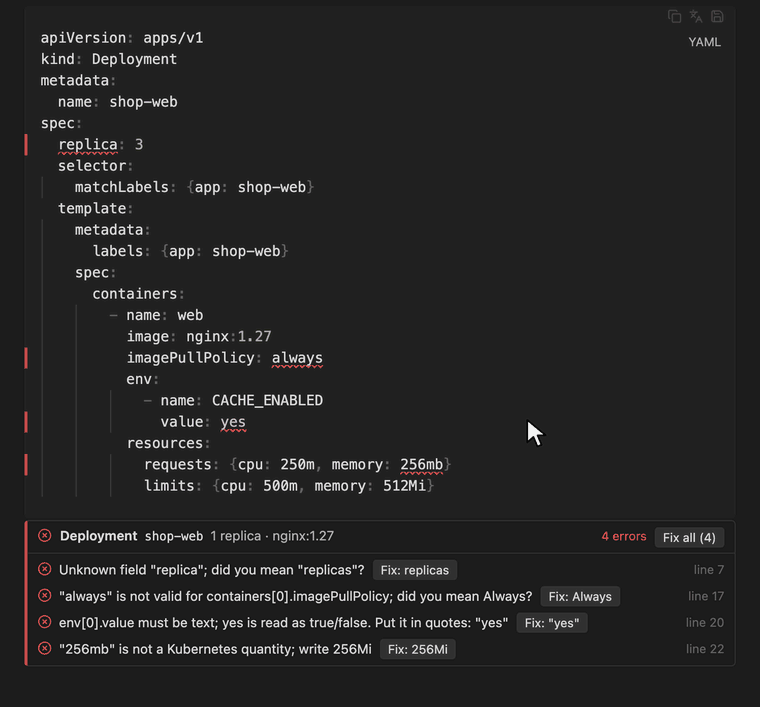
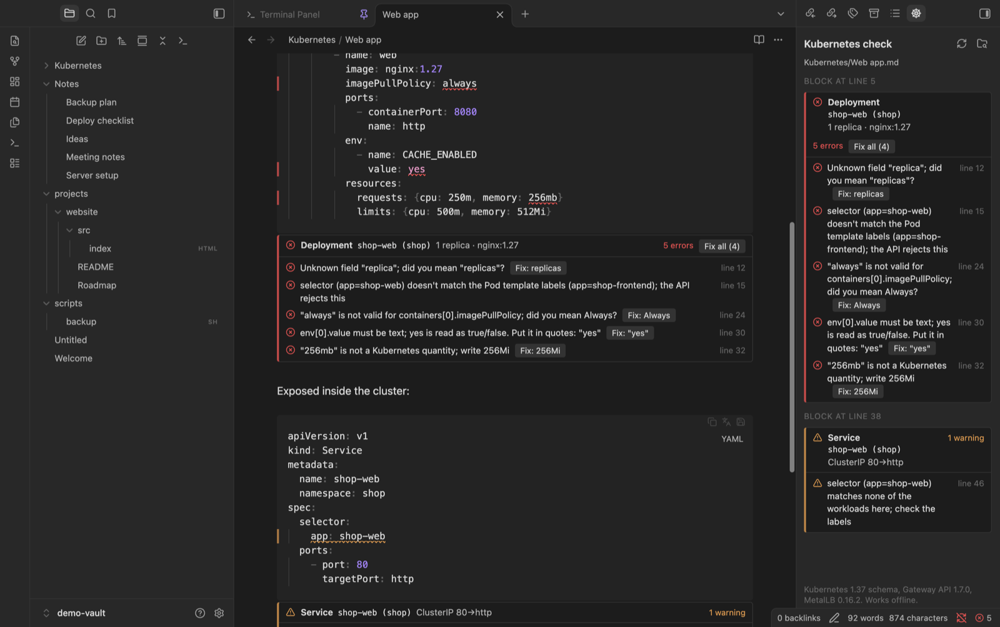
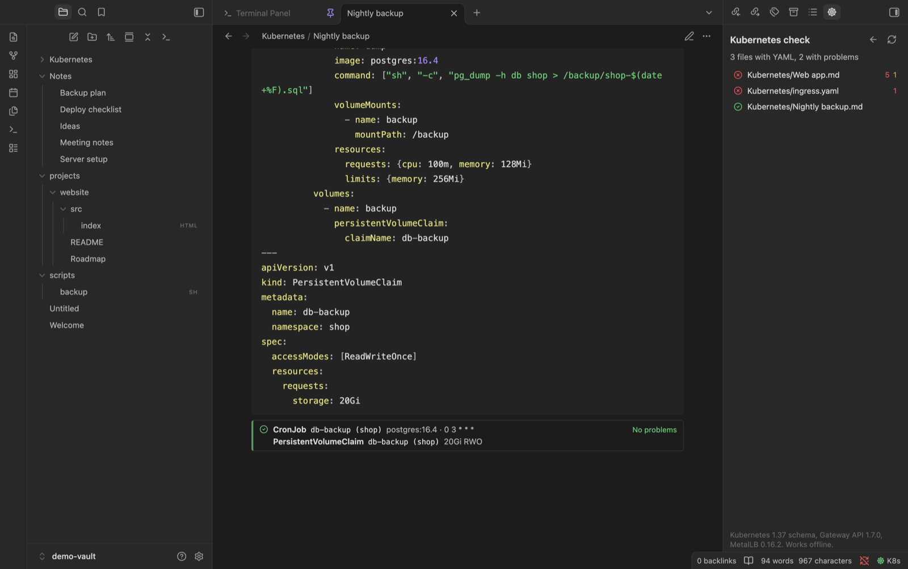

# ecu-kube

Checks the YAML and Kubernetes manifests in your notes while you write them. Typos, wrong
types, removed APIs and labels that don't line up are underlined in place, and each block
gets a short summary of what it defines.



## What it catches

- **YAML mistakes**: bad indentation, tabs, duplicate keys.
- **Unknown or misspelled fields**, with a suggestion: `replica` → `replicas`,
  `imagePullPolicy: always` → `Always`.
- **Wrong types**, including the classic YAML traps: `value: yes` or `value: 8080` in an env
  var or label is read as a boolean or a number and rejected by the API, so you're asked to
  quote it.
- **Bad quantities**: `512mb` → `512Mi`, memory written as `512m`, a request larger than its
  limit.
- **Removed or wrong API versions**: `extensions/v1beta1 Ingress` → `networking.k8s.io/v1`,
  `batch/v1beta1 CronJob` → `batch/v1`, a kind under the wrong group.
- **Things that would break at deploy time**: a Deployment selector that doesn't match its
  Pod labels, a volumeMount without a volume, a Job with `restartPolicy: Always`, a 6-field
  cron schedule, Secret data that isn't base64, invalid names.
- **Links between objects in the same note**: a Service whose selector matches nothing, a
  targetPort the Pods don't expose, an Ingress pointing at a missing Service port.
- Optional **best-practice hints**: untagged or `:latest` images, containers without
  resources, unused volumes.

Kubernetes 1.37 built-in kinds are checked against the official API schema, plus the custom
resources of Gateway API, MetalLB, cert-manager, Prometheus Operator and Argo CD. Other custom
resources get the basic checks. Blocks with Helm or
Jinja templates are skipped, and placeholders like `<name>` are left alone, so half-written
examples in your notes don't light up red. A block wrapped in `cat <<EOF | kubectl apply -f -`
is checked as the YAML inside it.

## One-click fixes

When the right value is clear, the problem comes with a **Fix** button: `replica` →
`replicas`, `always` → `Always`, `yes` → `"yes"`, `256mb` → `256Mi`, a removed `apiVersion` →
the current one, a missing `apiVersion`, a Job's `restartPolicy`, a 6-field cron schedule,
Secret data → base64, tabs → spaces. **Fix all** applies every fix in a block at once.



Fixes work from the block summary, the side panel and reading view. In the editor you can
also right-click an underlined value, or give **Fix the problem at the cursor** and **Fix
everything fixable in this file** a hotkey. Every fix is a normal edit, so `Cmd/Ctrl+Z` undoes
it. Things that need a decision from you, like which side of a mismatched selector is right,
are only reported.



## Where it shows up

- **Editing view**: the exact key or value is underlined; hover it to read the message.
  Under each `yaml` block a summary lists the objects (kind, name, replicas, image, ports,
  links) and the problems; click one to jump to its line.
- **Reading view**: the same summary under each block.
- **Side panel** (command "Open Kubernetes check panel" or the status bar item): every block
  in the current note, plus **Check the whole vault**.
- **`.yaml` / `.yml` files** opened with [ecu-codekit](https://github.com/erencanucarr/ecu-codekit)
  are underlined too.

Everything runs locally. The schema is bundled in the plugin and nothing is sent anywhere.

## Install

1. From the [latest release](https://github.com/erencanucarr/ecu-kube/releases/latest),
   download `main.js`, `manifest.json` and `styles.css` into
   `<your vault>/.obsidian/plugins/ecu-kube/`.
2. In Obsidian, open **Settings > Community plugins**, turn off Restricted mode if needed,
   and enable **ecu-kube**.

## Settings

Underlines, block summaries, best-practice hints, the status bar item and `.yaml` file checks
can each be switched off. The interface is available in English and Turkish and follows
Obsidian's language by default.

## Building

```bash
npm ci
npm test
npm run build
```

`npm run schema` regenerates `src/schema.json` from the Kubernetes OpenAPI spec and the
Gateway API, MetalLB, cert-manager, Prometheus Operator and Argo CD CRDs (versions are pinned
in `scripts/gen-schema.mjs`).

## License

MIT, see [LICENSE](LICENSE).
